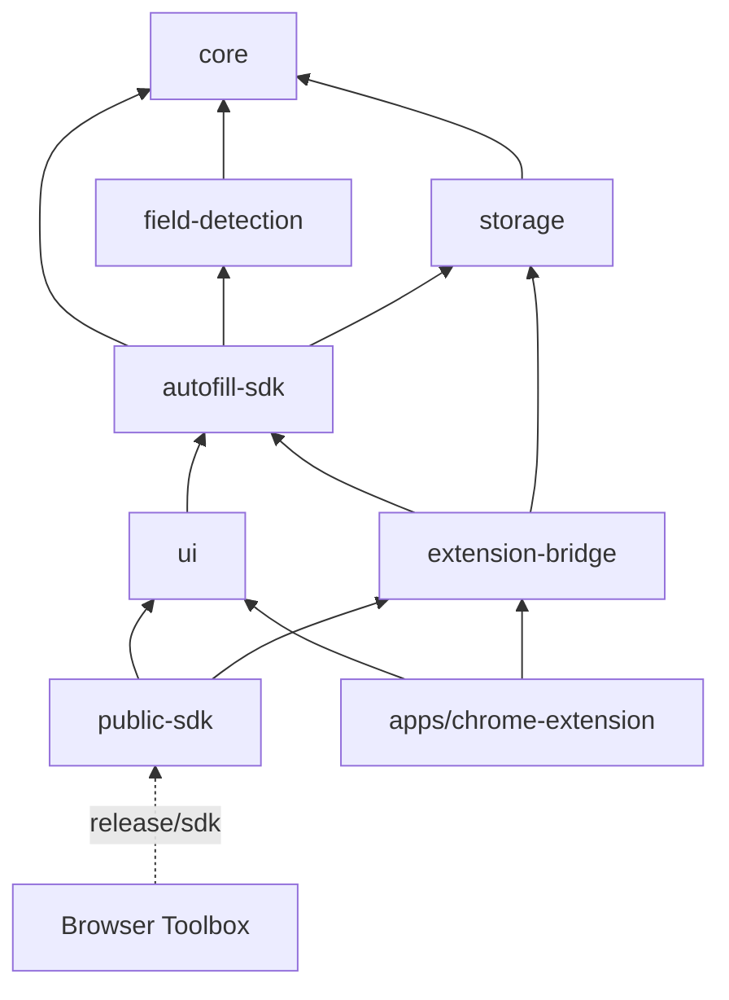
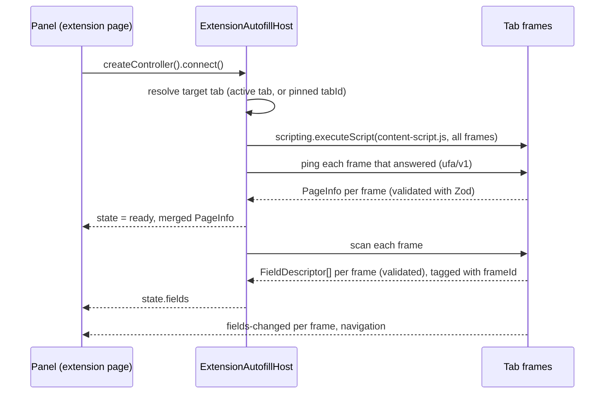

# Architecture

Universal Form Autofill is a form-filling engine with two delivery shapes built from the same code:

- **A standalone Chrome extension** (`apps/chrome-extension`): side panel, popup and options page.
- **One self-contained package** (`@universal-form-autofill/sdk`) that other extensions embed with a few
  lines, the way Browser Toolbox does.

Job applications are the first use case, but nothing in the engine knows about jobs. Portal-specific
knowledge lives in adapters, and field meaning comes from a semantic catalog that plugins can extend.

## Packages

| Package                     | Role                                                                                                                                       |
| --------------------------- | ------------------------------------------------------------------------------------------------------------------------------------------ |
| `packages/core`             | Domain types and their Zod schemas, error codes, events, the plugin registry, safety classification, semantic catalog, redacting logger    |
| `packages/field-detection`  | DOM scanner: detector plugins, label resolution, section context, visibility, stable field ids, mutation observer (see FIELD_DETECTION.md) |
| `packages/storage`          | `StorageAdapter` implementations: in-memory and any `chrome.storage`-compatible area, with namespaced keys                                 |
| `packages/autofill-sdk`     | Headless controller (`createAutofill`), the page runtime, the DOM page driver and the `ufa/v1` message protocol                            |
| `packages/extension-bridge` | Extension-page host: resolves the target tab, injects the runtime, proxies the page driver over `chrome.runtime` messaging                 |
| `packages/ui`               | React panel and shadcn/ui-based components, scoped stylesheet, theme adapter, messages                                                     |
| `packages/public-sdk`       | The published facade. Bundles everything above into `release/sdk`                                                                          |
| `apps/chrome-extension`     | The standalone MV3 extension                                                                                                               |

Later phases add `matching-engine`, `form-actions`, `learning-engine`, `synthetic-data` and
`portal-adapters` packages, plus `apps/demo-host-extension`, which may only import the public package.

### Dependency direction

`.dependency-cruiser.cjs` enforces this graph (`pnpm check:deps`). Packages never import apps, apps
never import each other, and there are no cycles.

Internal packages are source-first: their `exports` point at `src/*.ts`, so apps and tests use them
without a build step. Only `public-sdk` is ever built for consumers.

## Runtime model

Two halves cooperate. The **panel** runs on an extension page (side panel, popup, or a tool page
inside a host extension). The **page runtime** runs in the tab's frames as an injected content script.

- **Injection is on demand.** Nothing runs in a page until the panel connects to it, and nothing is
  registered as a persistent content script.
- **Re-injection is idempotent.** The runtime installs once per document; injecting the same version
  again is a no-op, and a different version replaces the old one so both halves always speak the same
  protocol.
- **Messages use their own channel.** Every message carries `channel: 'ufa/v1'`. Requests are matched
  by id, and every response is parsed with Zod on the receiving side, so a hostile page cannot hand
  the panel an unexpected shape. Host extensions' own messages are ignored by both halves, and theirs
  ignore ours.
- **Errors are actionable.** Injection failures are mapped to `PERMISSION_REQUIRED` (with the site to
  request, or `reason: 'file-access'`), `RESTRICTED_PAGE`, `NO_TAB` or `INJECTION_FAILED`, and the panel
  renders a specific state for each.

`PageDriver` (`connect`, `scan`, `subscribe`, `dispose`) is the only way the engine touches a page.
The DOM driver runs where the document lives (the content script, tests, or an in-page host) and
wraps the field scanner; after its first scan it watches the page and emits `fields-changed` with the
frame's complete field list whenever the structure changes. The extension tab driver implements the
same contract over messaging, fanning scans out to every reachable frame and stamping each field and
event with the sender's `frameId`. Descriptors never carry element references; actions re-find
elements by session id and check the fingerprint first.

### Controller and state

`createAutofill({ driver, storage })` returns an `AutofillController`: a small store
(`idle → connecting → ready | error`, then `destroyed`, plus `fields`, `scanning` and `scannedAt`), a
typed event bus, `connect()`, which connects and scans and may be called repeatedly (concurrent calls
share one attempt), and `scan()`. Page updates replace the fields of the frame that sent them; a
frame's report that arrives during a scan wins over the scan's older snapshot of that frame. React binds through
`useAutofillController(host)`, which owns the controller's lifetime, and `useAutofillState(controller)`.

`AutofillHost` is what a UI needs from its environment: `createController()` plus an optional
`requestPageAccess()` that must be called from a user gesture. `createExtensionAutofillHost` builds one
from the host's `chrome` object; it touches no extension API until a controller connects, so hosts can
create it at module scope.

## Plugins

`PluginRegistry` (in `core`) holds every extension point: `detector`, `classifier`, `matcher`,
`generator`, `validator`, `policy`, `portalAdapter` and `action`.

- Registrations are validated (id format, `PLUGIN_API_VERSION`, required methods). Duplicate ids throw
  unless `replace` is set. Listings are ordered by `(order, id)`, so execution is deterministic.
- `invokePlugin` isolates plugin failures: a throwing plugin is reported and skipped.
- Policies can only make a decision stricter (`mostRestrictive`): `block` beats `suggest`, which beats
  `confirm`, which beats `fill`.
- Plugins are code supplied by the host at build time. Saved values, imported configuration and page
  content can only reference registered ids; they can never introduce executable code.

## Safety

These rules belong to the engine, not to any UI, so every host gets them:

- `classifySensitivity` sorts controls into normal, consent and prohibited. Prohibited controls
  (passwords, one-time codes, payment fields, tokens, file inputs, authentication widgets) are never
  read, filled, cleared, learned or generated; the scanner does not even read their values.
- `type="hidden"` inputs are never detected. Hidden (including honeypots), disabled and read-only
  controls are left out of scans by default and are never filled or cleared.
- Consent, terms and declaration controls are never set automatically; each needs explicit selection.
- Non-empty fields are not overwritten by default, and forms are never submitted.
- Learning is opt-in. Synthetic values are marked as generated, are never stored as answers, and are
  blocked for factual and legal categories.
- Logging goes through a redacting logger. The engine makes no network requests; profile data stays in
  the storage adapter the host supplies.

## Storage

`StorageAdapter` is a small async key-value contract. Phase 1 ships the in-memory adapter and the
`chrome.storage` area adapter, which prefixes every key with the host's namespace (for example
`browser_toolbox_autofill`) so several products can share one storage area. IndexedDB and host-provided
adapters, schema migrations, and import/export arrive with profiles in Phase 3.

## Styling and theming

The panel has to look native in hosts that ship their own Tailwind, preflight and global CSS, without
affecting them.

- Every utility is generated with Tailwind's `prefix(ufa)` (`ufa:flex`), and `cn()` uses a matching
  `tailwind-merge` configuration.
- There is no global preflight. A minimal reset is scoped to `:where(.ufa-root)` (zero specificity), and
  the build renames Tailwind's internal `--tw-*` variables to `--ufa-tw-*` and scopes their fallback
  rule, so no selector in `style.css` can match host markup.
- Utilities are emitted **unlayered**. Hosts commonly ship unlayered globals such as
  `* { border-color: var(--border) }`, which beat any layered rule; an unlayered single-class utility
  still wins over those element selectors.
- Tokens live on `.ufa-root` as `--ufa-*` variables that default to built-in `--ufa-d-*` values.
  `cssVariableTheme()` maps them onto a host's shadcn-style variables (`--primary`, `--background`,
  `--radius`, …) with the built-in value as fallback, and follows the host's `.dark` class or
  `data-theme` attribute.
- Radix portals render into a body-level `div.ufa-root[data-ufa-portal]` that carries the same theme,
  so dialogs and menus keep the panel's styles.

## Packaging

`pnpm build:package` writes `release/sdk/`, shaped like a future npm publish:

- Subpath exports `.`, `./react`, `./extension` and `./content`, plus `./style.css` and
  `./content-script.js` (the prebuilt IIFE page runtime) and the `ufa-assets` bin that copies it into a
  host's static folder.
- A generated `package.json` with **no runtime dependencies**. Zod, Radix, lucide and the internal
  packages are bundled with tsdown; React and React DOM are optional peers.
- Declarations are bundled too. Public types are written out by hand (not `z.infer`) so declarations
  never import Zod, and type-level tests keep each one identical to its schema. The build fails if any
  emitted file imports something other than a peer or its own chunks.
- `pnpm test:package` installs the release into a throwaway project and checks a strict typecheck
  (`skipLibCheck: false`, `exactOptionalPropertyTypes`), that the real `chrome` global satisfies the
  bridge types, runtime imports of every subpath, and the `ufa-assets` bin.

## Standalone extension

The extension requests `sidePanel`, `storage`, `activeTab` and `scripting`, with `http(s)://*/*` as
optional host permissions requested per site from the panel. Without `tabs`, Chrome hides tab URLs
until access is granted; the panel says so instead of guessing. `Alt+Shift+F` opens the side panel.
The E2E build (`vite build --mode e2e`) adds host permissions for `127.0.0.1` and `localhost` only.

## Testing

| Layer                | Tooling                              | Command                                      |
| -------------------- | ------------------------------------ | -------------------------------------------- |
| Unit and component   | Vitest, jsdom, React Testing Library | `pnpm test`                                  |
| Type contracts       | `tsc` (schema/type identity checks)  | `pnpm typecheck`                             |
| Dependency direction | dependency-cruiser                   | `pnpm check:deps`                            |
| Packaged SDK         | throwaway consumer project           | `pnpm test:package`                          |
| Extension E2E        | Playwright with the unpacked build   | `pnpm e2e`                                   |
| Host integration     | Playwright against a host's `dist`   | `UFA_TOOLBOX_DIST=../dist pnpm e2e` (opt-in) |
