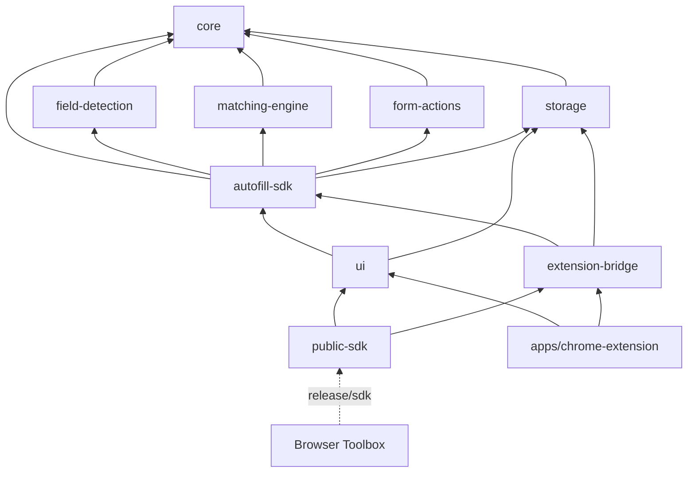
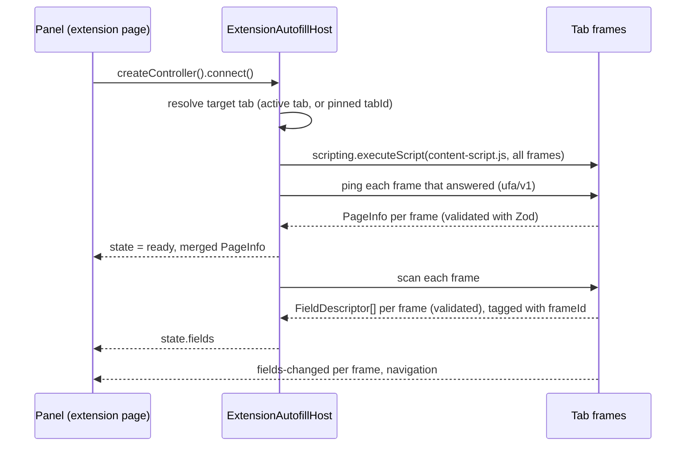

# Architecture

Universal Form Autofill is a form-filling engine with two delivery shapes built from the same code:

- **A standalone Chrome extension** (`apps/chrome-extension`): side panel, popup and options page.
- **One self-contained package** (`@universal-form-autofill/sdk`) that other extensions embed with a few
  lines, the way Browser Toolbox does.

Job applications are the first use case, but nothing in the engine knows about jobs. Portal-specific
knowledge lives in adapters, and field meaning comes from a semantic catalog that plugins can extend.

## Packages

| Package                     | Role                                                                                                                                        |
| --------------------------- | ------------------------------------------------------------------------------------------------------------------------------------------- |
| `packages/core`             | Domain types and their Zod schemas, error codes, events, the plugin registry, safety classification, semantic catalog, redacting logger     |
| `packages/field-detection`  | DOM scanner: detector plugins, label resolution, section context, visibility, stable field ids, mutation observer (see FIELD_DETECTION.md)  |
| `packages/matching-engine`  | Field classification, the ordered matching strategies, confidence, option and value conversion (see Matching below)                         |
| `packages/form-actions`     | Policy evaluation, fill/clear/restore execution, per-control adapters, post-fill verification and undo snapshots (see Filling below)        |
| `packages/storage`          | The profiles-and-answers store, migrations, import/export, and adapters: memory, `chrome.storage`, IndexedDB, host-provided (DATA_MODEL.md) |
| `packages/autofill-sdk`     | Headless controller (`createAutofill`), the page runtime, the DOM page driver and the `ufa/v1` message protocol                             |
| `packages/extension-bridge` | Extension-page host: resolves the target tab, injects the runtime, proxies the page driver over `chrome.runtime` messaging                  |
| `packages/ui`               | React panel and shadcn/ui-based components, scoped stylesheet, theme adapter, messages                                                      |
| `packages/public-sdk`       | The published facade. Bundles everything above into `release/sdk`                                                                           |
| `apps/chrome-extension`     | The standalone MV3 extension                                                                                                                |

Later phases add `learning-engine`, `synthetic-data` and `portal-adapters` packages, plus
`apps/demo-host-extension`, which may only import the public package.

### Dependency direction

`.dependency-cruiser.cjs` enforces this graph (`pnpm check:deps`). Packages never import apps, apps
never import each other, and there are no cycles.

Internal packages are source-first: their `exports` point at `src/*.ts`, so apps and tests use them
without a build step. Only `public-sdk` is ever built for consumers.

## Runtime model

Two halves cooperate. The **panel** runs on an extension page (side panel, popup, or a tool page
inside a host extension). The **page runtime** runs in the tab's frames as an injected content script.

- **Injection is on demand.** Nothing runs in a page until the panel connects to it, and nothing is
  registered as a persistent content script.
- **Re-injection is idempotent.** The runtime installs once per document; injecting the same version
  again is a no-op, and a different version replaces the old one so both halves always speak the same
  protocol.
- **Messages use their own channel.** Every message carries `channel: 'ufa/v1'`. Requests are matched
  by id, and every response is parsed with Zod on the receiving side, so a hostile page cannot hand
  the panel an unexpected shape. Host extensions' own messages are ignored by both halves, and theirs
  ignore ours.
- **Errors are actionable.** Injection failures are mapped to `PERMISSION_REQUIRED` (with the site to
  request, or `reason: 'file-access'`), `RESTRICTED_PAGE`, `NO_TAB` or `INJECTION_FAILED`, and the panel
  renders a specific state for each.

`PageDriver` (`connect`, `scan`, `fill`, `restore`, `subscribe`, `dispose`) is the only way the
engine touches a page. The DOM driver runs where the document lives (the content script, tests, or an
in-page host) and wraps the field scanner plus `createFormActions`; after its first scan it watches
the page and emits `fields-changed` with the frame's complete field list whenever the structure
changes. The extension tab driver implements the same contract over messaging, fanning scans and
fills out to every reachable frame and stamping each field and event with the sender's `frameId`.
Descriptors never carry element references; actions re-find elements by session id and check the
fingerprint first. Fields inside `.ufa-root`, `[data-ufa-portal]` or `[data-ufa-ignore]` are never
detected, so an embedded panel does not scan or fill its own controls.

### Controller and state

`createAutofill({ driver, storage })` returns an `AutofillController`: a small store
(`idle → connecting → ready | error`, then `destroyed`, plus `fields`, `matches`, `scanning` and
`scannedAt`), a
typed event bus, `connect()`, which connects and scans and may be called repeatedly (concurrent calls
share one attempt), and `scan()`. Page updates replace the fields of the frame that sent them; a
frame's report that arrives during a scan wins over the scan's older snapshot of that frame. React binds through
`useAutofillController(host)`, which owns the controller's lifetime, and `useAutofillState(controller)`.

Each controller exposes `controller.store`, the profiles-and-answers store. Pass `store` to share one
across controllers; otherwise the controller creates one over `storage` and disposes it on
`destroy()`. Store changes are re-emitted on the event bus as `data:changed` (per collection) and
`profile:changed`. The panel shows the store in its Answers, Profiles and Data tabs, with the profile
selector above them, so saved data stays manageable on pages that cannot be read.

The controller keeps the fields exactly as the driver reported them and publishes them classified
(with `semanticKey`, `semanticConfidence` and `semanticReason`), together with `matches`: one
`MatchResult` per field id. Both are recomputed when fields change and when the answers, custom
fields, mappings, active profile or thresholds change, and each recomputation emits
`match:complete` with the count per state. Pass `registry` to add classifiers and matching
strategies; the built-in ones always run. Matching never changes the page.

## Filling

After matching, the controller runs each field through the **policy pipeline**
(`evaluatePolicies` in `packages/form-actions`). Policies return an action: `block`, `suggest`,
`confirm`, `fill`, or `skip`, plus a user-facing reason. The built-in `safetyPolicy` respects mode
(suggest, review, trusted), sensitivity (consent never auto-fills), match state, existing values,
generated values and trusted-site rules. Custom policy plugins register on the controller's
`PluginRegistry` and can only make decisions stricter.

The panel shows each decision, lets the user select fields (confident matches start selected; consent
never does), pick among ambiguous answers, and call `controller.fill({ fieldIds, choices })` or
`controller.undo()`. In trusted mode on a listed site, high-confidence empty fields may fill without
selection; the popup offers a one-click action for those.

On the page, `createFormActions` refuses prohibited or unsupported controls again, skips non-empty
fields unless overwriting is enabled, writes through **control adapters** (native prototype setters
plus `input`/`change` for framework-controlled inputs, async `<select>` options, ARIA listbox
activation with keyboard fallbacks), verifies the value stuck, and records an undo snapshot. The tab
driver groups operations by frame, runs frames in order, and rewrites per-frame snapshot ids into one
combined id for `restore`. Fill and undo are serialized through the controller queue; events such as
`fill:complete` and `restore:complete` carry ids and statuses only, never profile values.

`AutofillHost` is what a UI needs from its environment: `createController()` plus an optional
`requestPageAccess()` that must be called from a user gesture. `createExtensionAutofillHost` builds one
from the host's `chrome` object; it touches no extension API until a controller connects, so hosts can
create it at module scope. Its `getStore()` returns the single store all of its controllers share,
which is also what the extension's options page uses.

## Plugins

`PluginRegistry` (in `core`) holds every extension point: `detector`, `classifier`, `matcher`,
`generator`, `validator`, `policy`, `portalAdapter` and `action`.

- Registrations are validated (id format, `PLUGIN_API_VERSION`, required methods). Duplicate ids throw
  unless `replace` is set. Listings are ordered by `(order, id)`, so execution is deterministic.
- `invokePlugin` isolates plugin failures: a throwing plugin is reported and skipped.
- Policies can only make a decision stricter (`mostRestrictive`): `block` beats `suggest`, which beats
  `confirm`, which beats `fill`.
- Plugins are code supplied by the host at build time. Saved values, imported configuration and page
  content can only reference registered ids; they can never introduce executable code.

## Matching

`packages/matching-engine` decides which saved answer belongs in which field. It runs beside the
controller, never in the page, and uses no network service or language model. Every decision comes
with a sentence explaining it.

### Classification

Each field first gets a semantic key (`email`, `noticePeriod`, `custom:office`, …). The catalog
classifier tries these rules in order and stops at the first that applies:

| Rule                                                     | Confidence |
| -------------------------------------------------------- | ---------- |
| `autocomplete` token (`given-name`, `email`, …)          | 0.98       |
| Normalized label equals exactly one key's label or alias | 0.95       |
| Field `name` or `id`, split into words                   | 0.88       |
| Placeholder equals a label or alias                      | 0.90       |
| Label contains a known phrase (two or more words)        | 0.75       |
| Label contains a known single word                       | 0.65       |
| `type="email"` or `type="tel"`                           | 0.85       |
| Label closely resembles one key and clearly no other     | up to 0.75 |

Normalization makes "First name \*", "Candidate First Name" and "Enter your first name" the same
label. Vague words ("name", "first", "state", "date") never count when a label merely contains them,
and single checkboxes are not classified from contained phrases at all. The user's custom fields are
classified by the same rules, and registry classifiers run alongside. The most confident result wins.
A key a portal adapter already set with higher confidence is kept. Fields about someone else (an
emergency contact, referee, next of kin, spouse, parent, guardian or manager) never receive
personal, contact or address keys.

### Strategies

The strategies run in this order. Each saved answer is credited to the first strategy that finds it:

| Order | Strategy         | Score                                                                                                                             |
| ----- | ---------------- | --------------------------------------------------------------------------------------------------------------------------------- |
| 10    | Explicit mapping | 1.0: the user linked this field (`normalized label\|type`) to an answer on this site                                              |
| 20    | Semantic key     | 0.5 + 0.5 × the field's classification confidence                                                                                 |
| 30    | Exact label      | 0.95                                                                                                                              |
| 40    | Alias            | 0.92                                                                                                                              |
| 50    | Context          | 0.9 when section or form title plus label equals the answer's label; 0.8 when they cover its words, at least one from the section |
| 60    | Fuzzy            | similarity × 0.9 for similarity ≥ 0.6, capped at 0.85                                                                             |
| 70    | Suggestion       | 0.35 to 0.6 from shared distinctive words                                                                                         |

Registry matchers join the list by their `order`. Then, for each candidate:

1. **Context.** The answer's own rules (sites, section keywords, form keywords, application types)
   and control types must allow this field, except for explicit mappings. Each matched rule adds
   0.02, up to 0.06, never past a strategy's cap. The user's personal answers are never offered for
   fields about someone else.
2. **Value conversion.** `toFieldValue` expresses the answer for this control or explains why it
   cannot. It validates formats (email, phone, URL, number, date, month, week, time) and
   `maxLength`, and matches options against the control's real options: by value, by label, by yes/no
   meaning, by numeric range ("4" picks "3-5 years"), or by containment when exactly one option
   fits. Placeholder options are never chosen. The conversion's score multiplies the confidence:
   1 for exact, 0.97 for yes/no, 0.95 for a range, 0.85 for containment, and 0.9 for free text in a
   combobox whose options do not include it.
3. **Confidence level.** High is 0.90 or more, medium 0.70 or more, and low is below 0.70. The
   thresholds come from settings. Fuzzy, suggestion and contained-phrase matches stay below the
   default high threshold: resemblance alone never proves two labels mean the same thing.

Candidates are ranked by level, strategy order, score, context specificity, preferred answer,
profile answer before global answer, usage, recency and finally id. The result's `state` is:

| State          | When                                                                                            |
| -------------- | ----------------------------------------------------------------------------------------------- |
| `matched`      | The best candidate is high confidence                                                           |
| `suggested`    | The best candidate is medium or low confidence                                                  |
| `ambiguous`    | The top two cannot be told apart and offer different values, or the answer fits several options |
| `incompatible` | A saved answer was found but cannot be expressed for this control                               |
| `missing`      | No saved answer fits                                                                            |
| `skipped`      | Protected or read-only field                                                                    |
| `unsupported`  | The control type is not supported                                                               |

Results are deterministic: the same fields, answers and settings give the same results whatever the
order of the saved answers. Lookups use an index built once per answer list. Fuzzy matching compares
every answer when there are at most 200 and only answers sharing a word otherwise. Phase 5 decides
what may actually be filled; matching only proposes.

## Safety

These rules belong to the engine, not to any UI, so every host gets them:

- `classifySensitivity` sorts controls into normal, consent and prohibited. Prohibited controls
  (passwords, one-time codes, payment fields, tokens, file inputs, authentication widgets) are never
  read, filled, cleared, learned or generated; the scanner does not even read their values.
- `type="hidden"` inputs are never detected. Hidden (including honeypots), disabled and read-only
  controls are left out of scans by default and are never filled or cleared.
- Consent, terms and declaration controls are never set automatically; each needs explicit selection.
- Non-empty fields are not overwritten by default, and forms are never submitted.
- Answers and custom fields whose labels look like secrets are rejected when saved and skipped on
  import.
- Learning is opt-in. Synthetic values are marked as generated, are never stored as answers, and are
  blocked for factual and legal categories.
- Logging goes through a redacting logger. The engine makes no network requests; profile data stays in
  the storage adapter the host supplies.

## Storage

`StorageAdapter` (in `core`) is a small async key-value contract with optional atomic `setMany`,
change subscriptions and declared `capabilities`. `packages/storage` provides four adapters: in-memory,
any `chrome.storage` area, IndexedDB, and a wrapper for host-provided backends. Each prefixes keys with
the host's namespace (for example `browser_toolbox_autofill`) so several products can share one area.

`createAutofillStore` builds the data layer on top: one validated document per collection (profiles,
answers, custom fields, mappings, settings), a versioned `meta` document, migrations written in a
single batch, serialized writes, live reloads on external changes, duplicate detection, and
import/export with a preview. Data written by a newer version is left untouched and the store reports
an error instead of rewriting it. DATA_MODEL.md documents the records, the guarantees and the
limitations.

## Styling and theming

The panel has to look native in hosts that ship their own Tailwind, preflight and global CSS, without
affecting them.

- Every utility is generated with Tailwind's `prefix(ufa)` (`ufa:flex`), and `cn()` uses a matching
  `tailwind-merge` configuration.
- There is no global preflight. A minimal reset is scoped to `:where(.ufa-root)` (zero specificity), and
  the build renames Tailwind's internal `--tw-*` variables to `--ufa-tw-*` and scopes their fallback
  rule, so no selector in `style.css` can match host markup.
- Utilities are emitted **unlayered**. Hosts commonly ship unlayered globals such as
  `* { border-color: var(--border) }`, which beat any layered rule; an unlayered single-class utility
  still wins over those element selectors.
- Tokens live on `.ufa-root` as `--ufa-*` variables that default to built-in `--ufa-d-*` values.
  `cssVariableTheme()` maps them onto a host's shadcn-style variables (`--primary`, `--background`,
  `--radius`, …) with the built-in value as fallback, and follows the host's `.dark` class or
  `data-theme` attribute.
- Radix portals render into a body-level `div.ufa-root[data-ufa-portal]` that carries the same theme,
  so dialogs and menus keep the panel's styles.

## Packaging

`pnpm build:package` writes `release/sdk/`, shaped like a future npm publish:

- Subpath exports `.`, `./react`, `./extension` and `./content`, plus `./style.css` and
  `./content-script.js` (the prebuilt IIFE page runtime) and the `ufa-assets` bin that copies it into a
  host's static folder.
- A generated `package.json` with **no runtime dependencies**. Zod, Radix, lucide and the internal
  packages are bundled with tsdown; React and React DOM are optional peers.
- Declarations are bundled too. Public types are written out by hand (not `z.infer`) so declarations
  never import Zod, and type-level tests keep each one identical to its schema. The build fails if any
  emitted file imports something other than a peer or its own chunks.
- `pnpm test:package` installs the release into a throwaway project and checks a strict typecheck
  (`skipLibCheck: false`, `exactOptionalPropertyTypes`), that the real `chrome` global satisfies the
  bridge types, runtime imports of every subpath, and the `ufa-assets` bin.

## Standalone extension

The extension requests `sidePanel`, `storage`, `activeTab` and `scripting`, with `http(s)://*/*` as
optional host permissions requested per site from the panel. Without `tabs`, Chrome hides tab URLs
until access is granted; the panel says so instead of guessing. `Alt+Shift+F` opens the side panel.
The E2E build (`vite build --mode e2e`) adds host permissions for `127.0.0.1` and `localhost` only.

## Testing

| Layer                | Tooling                              | Command                                      |
| -------------------- | ------------------------------------ | -------------------------------------------- |
| Unit and component   | Vitest, jsdom, React Testing Library | `pnpm test`                                  |
| Type contracts       | `tsc` (schema/type identity checks)  | `pnpm typecheck`                             |
| Dependency direction | dependency-cruiser                   | `pnpm check:deps`                            |
| Packaged SDK         | throwaway consumer project           | `pnpm test:package`                          |
| Extension E2E        | Playwright with the unpacked build   | `pnpm e2e`                                   |
| Host integration     | Playwright against a host's `dist`   | `UFA_TOOLBOX_DIST=../dist pnpm e2e` (opt-in) |
